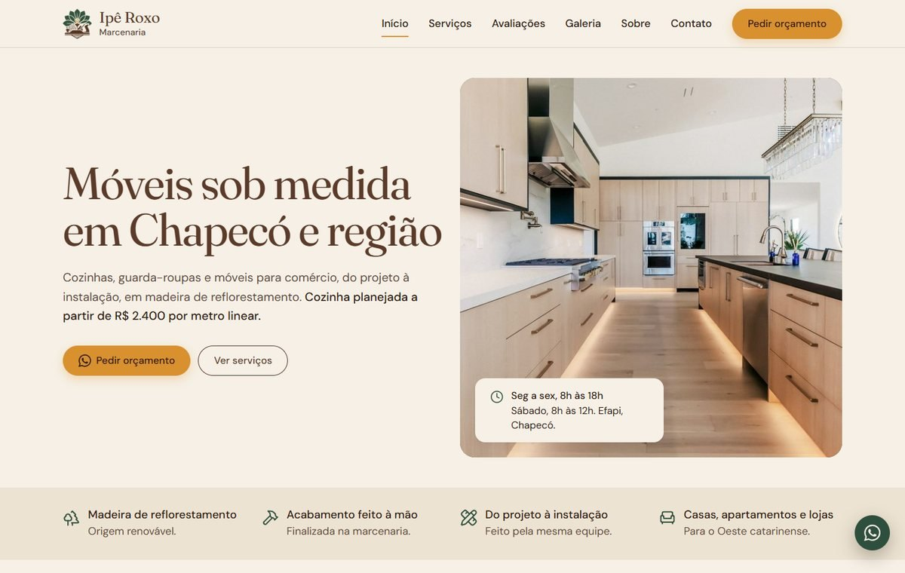
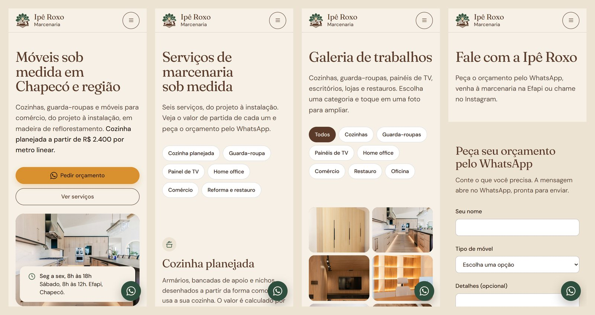
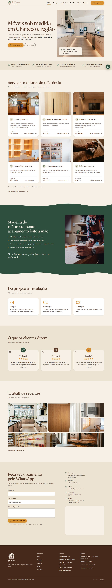
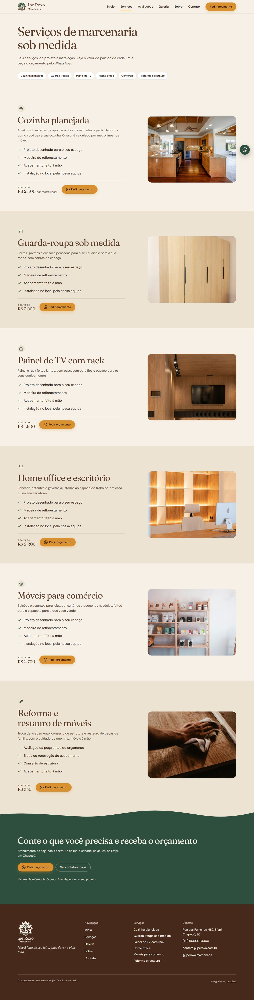
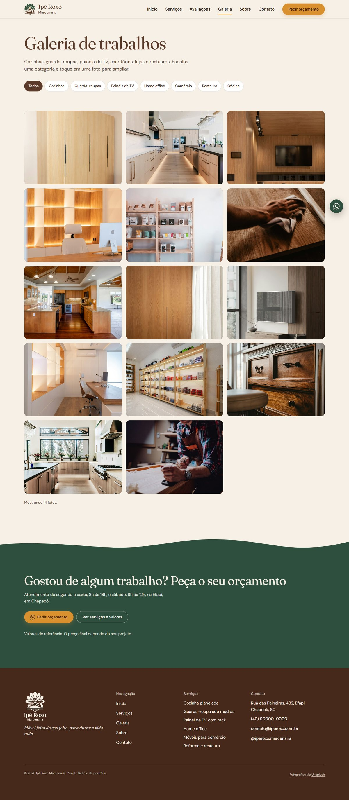
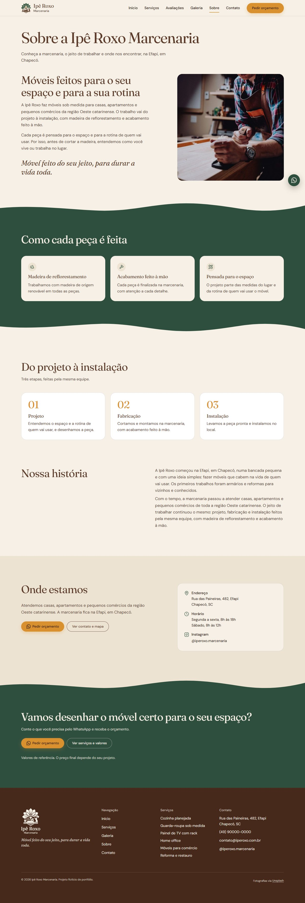
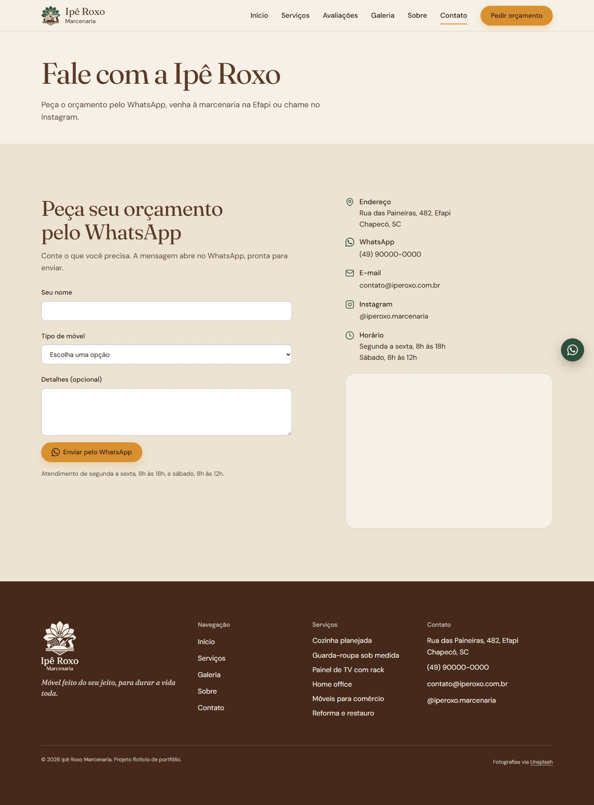

# Ipê Roxo Marcenaria

Site de apresentação para uma marcenaria de móveis planejados sob medida em Chapecó (SC). Projeto de portfólio com cliente fictício: nome, telefone, endereço e e-mail são de exemplo.



## Páginas

| Página | O que tem |
|---|---|
| **Início** | Hero com preço de referência, diferenciais, seis serviços, processo, avaliações, galeria e contato |
| **Serviços** | Uma seção por serviço, com valor "a partir de" e pedido de orçamento pelo WhatsApp |
| **Galeria** | 14 fotos com filtro por categoria (o filtro vai para o endereço) e ampliação com teclado |
| **Sobre** | Quem somos, como cada peça é feita, história e onde estamos |
| **Contato** | Formulário que monta a mensagem e abre o WhatsApp, dados de contato e mapa |
| **404** e **Créditos** | Página de erro e créditos das fotografias |

## Celular



<details>
<summary>Ver as páginas inteiras (desktop)</summary>

**Início**



**Serviços**



**Galeria**



**Sobre**



**Contato**



</details>

## Recursos

- Botão flutuante do WhatsApp (só o ícone no topo da página, com texto depois de rolar)
- Menu que marca a seção visível ao rolar a página inicial
- Formulário com validação, erros ao lado de cada campo e mensagem pronta para o WhatsApp
- Galeria com filtro, ampliação, navegação por setas do teclado e `Esc` para fechar
- Mapa do Google incorporado pelo endereço
- Layout responsivo (celular, tablet e desktop) e respeito a `prefers-reduced-motion`
- Imagens em três tamanhos (`srcset`), `loading="lazy"` e pré-visualização para compartilhamento
- Página 404, `sitemap.xml`, `robots.txt` e dados estruturados de empresa local

## Tecnologias

HTML, CSS e JavaScript puros, sem build e sem dependências em tempo de execução.

- Fontes: [Fraunces](https://fonts.google.com/specimen/Fraunces) e [DM Sans](https://fonts.google.com/specimen/DM+Sans) (Google Fonts)
- Ícones: [Lucide](https://lucide.dev) (ISC), e WhatsApp e Google do [Simple Icons](https://simpleicons.org) (CC0)
- Fotografias: [Unsplash](https://unsplash.com) (licença Unsplash). Autores em [`assets/img/CREDITOS.md`](assets/img/CREDITOS.md)

## Identidade visual

| Papel | Cor |
|---|---|
| Marrom nogueira | `#5B3A29` |
| Verde musgo | `#2F4F3E` |
| Âmbar | `#D9902F` |
| Creme | `#F6F0E6` |

## Como rodar

```bash
python -m http.server 8080
```

Abra http://127.0.0.1:8080/index.html. Qualquer servidor estático serve.

## Estrutura

```
index.html  servicos.html  galeria.html  sobre.html  contato.html
404.html    creditos.html  sitemap.xml   robots.txt  share.jpg  _headers
assets/
  css/style.css     estilos de todas as páginas
  js/main.js        menu, galeria, formulário, botão flutuante
  js/icons.js       ícones embutidos
  img/              fotos em 3 tamanhos (800, 1200 e 1600 px)
  logo/             logo em PNG com fundo transparente
scripts/            verificações e geração de prints e da pasta de publicação
docs/               guia de publicação e prints
```

## Verificações

```bash
python scripts/verificar_links.py     # links, imagens e âncoras locais
python scripts/auditar_html.py        # imagens sem tamanho, rótulos, títulos, ids
node scripts/teste_site.js            # testes no navegador (Playwright): 4 larguras e interações
```

## Publicação

Veja [`docs/PUBLICAR.md`](docs/PUBLICAR.md). Para gerar a pasta com só o que vai para o ar:

```bash
python scripts/preparar_publicacao.py
```

## Aviso

Projeto de demonstração. A empresa, o telefone, o e-mail e o endereço não existem. Os valores dos serviços são exemplos.
